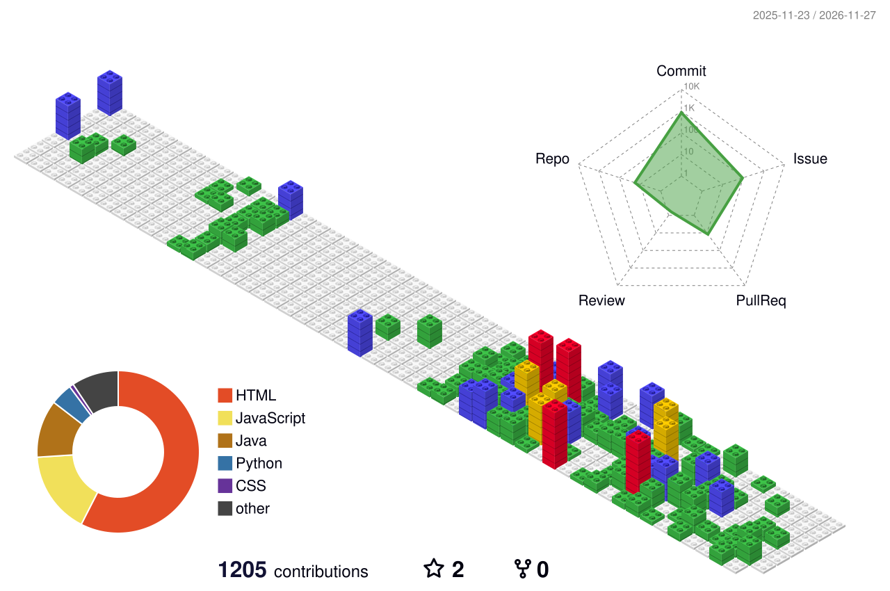

# 👋 Hi, I'm Hashio

Web開発やデザインを中心に、Webサイト制作やプログラミングの学習、作品制作に取り組んでいます。

I focus on web development and design, engaging in activities such as website creation, learning programming, and producing projects.

**[ポートフォリオを見る](https://hashio251.github.io/)** · [公開リポジトリ一覧](https://github.com/hashio251?tab=repositories)

---

## 📁 Repository Categories

GitHub上のリポジトリは、制作内容ごとに番号で分類しています。

Repositories on GitHub are categorized by the type of work.

| No. | Category | Description |
| --- | --- | --- |
| **00** | Practice | プログラミングやWeb制作の学習・練習 Programming and web development practice |
| **01** | Websites | GitHub Pagesなどで公開しているWebサイト・Web制作物 Published websites and web projects |
| **02** | Small Works | 小作品・実験的な制作物・コレクション Small projects, experiments, and collections |
| **03** | Python App | Python・Django・Flaskを使ったアプリ Applications built with Python, Django, or Flask |
| **04** | JavaScript App | Vanilla JavaScriptやReact、Next.jsを使ったアプリ Applications built with JavaScript, React, or Next.js |
| **05** | Java App | JavaやSpring Bootを使ったアプリ Applications built with Java or Spring Boot |
| **06** | Google Apps Script | Gmailなどの繰り返し作業を自動化するスクリプト Scripts for automating recurring work in Google Workspace |

---

## 🛠 Technologies, Skills & Tools

`*` は学習中の技術です。 An asterisk marks a technology I’m learning.

### Frontend

* HTML
* CSS
* JavaScript `*`
* p5.js
* OpenProcessing
* React `*`
* Next.js `*`

### Backend / Programming

* PHP `*`
* Python
* TypeScript `*`
* Java `*`
* Django
* Flask
* Pandas

### Database

* MySQL
* SQLite
* PostgreSQL `*`

### CMS

* WordPress

### Server / Hosting / DNS

* Docker `*`
* さくらインターネット
* お名前.com

### Development Tools

* Visual Studio Code
* Eclipse
* Git
* GitHub
* GitHub Pages
* FileZilla
* Google Apps Script

### Operating Systems

* Windows
* macOS
* Linux
* Ubuntu
* Debian

### Shell / Command Line

- PowerShell
- Bash
- Terminal

### Design Tools

* Adobe Photoshop
* Adobe Lightroom
* Adobe Fresco
* Adobe Illustrator
* Adobe Premiere
* Adobe After Effects
* Adobe XD
* Figma
* Blender `*`

---

## 📊 GitHub Activity

---

## 📈 GitHub Statistics

---

## 🌈 GitHub 3D Contribution

---

## 🎓 Certifications

- 情報セキュリティマネジメント試験 — 2026年5月取得
  - Information Security Management Examination — Obtained in May, 2026
- 3級 ウェブデザイン技能士 — 2026年9月取得
  - Grade 3 Web Design Technician — Obtained in September, 2026

---

## 🌱 Currently Learning

フロントエンド・バックエンドのWeb開発を中心に、サーバー・DNS・データベースなど、WebサイトやWebアプリケーションが動く仕組みについて学んでいます。

I am learning about the mechanisms that power websites and web applications—including servers, DNS, and databases—with a primary focus on frontend and backend web development.

また、GitHubを活用したバージョン管理やチーム開発、Issue・Projects・Pull Requestなどを使った開発フローについても学習しています。

I am also learning about version control and team development using GitHub, as well as development workflows that utilize features such as Issues, Projects, and Pull Requests.

現在はJava / Spring BootとSQL / PostgreSQLを学び、フォームから受け取った入力を処理し、データベースに保存するところまで実装しています。

---

## 👥 Team Development

### 緩い紐帯 チュータイ君｜都知事杯オープンデータ・ハッカソン 2026（2026年7〜8月）

地域の掲示板をスマホで撮影し、イベント情報を登録・共有できるアプリです。Next.jsとTypeScriptで、プロフィールまわりのUIを担当しました。

- 写真を選択してから、保存前にプレビューや選択の取り消しができる操作を実装。
- プロフィール編集メニューをコンポーネント化して既存画面に組み込み、プロフィール画面からのログアウトを実装。
- ヘッダーや戻るボタンの配置・配色を調整。

[公式作品ページ](https://odhackathon.metro.tokyo.lg.jp/collection/6632812913413127338/?year=2026)

### Habito｜Tech Jam KDG 2026 Winter（2026年2月）

食事や生活習慣を記録し、レシピの提案を受けられるDjangoアプリです。企画・コンセプト設計に参加し、ログイン・マイページ・投稿などの画面を実装しました。

- 既存デザインをもとにHTML・CSSで画面を実装し、PCとスマートフォンの両方に対応。
- ログインや投稿の画面をDjangoのテンプレートに組み込み、ヘッダーやナビゲーションなどの共通部分を `base.html` に整理。
- 担当画面の実装には生成AIを使用していません。

[リポジトリ](https://github.com/Tech-Jam-KDG-2026-Winter/Team-8-Django) · [担当PR #38](https://github.com/Tech-Jam-KDG-2026-Winter/Team-8-Django/pull/38) · [担当PR #44](https://github.com/Tech-Jam-KDG-2026-Winter/Team-8-Django/pull/44)

### Blog Application｜2025年12月

FlaskとSQLiteを使ったブログのチーム制作です。記事の投稿・一覧・詳細画面と、それらをつなぐルーティングの初期実装を担当しました。SQLAlchemyで記事とコメントのモデルを定義し、フォームからの投稿、SQLiteへの保存、一覧や詳細画面への表示までつなげました。いいねとコメント投稿の処理も初期PRに含めています。

[リポジトリ](https://github.com/kdgblogteam/blogapplication) · [担当PR #2](https://github.com/kdgblogteam/blogapplication/pull/2)

---

## 📌 Portfolio

GitHub Pagesやポートフォリオサイトを通して、制作したWebサイトや作品を公開しています。

I showcase the websites and projects I have created via GitHub Pages and my portfolio site.

---

## 🔗 GitHub Pages Collection

### 🌐 Portfolio Website

Webサイト・アプリ・アート作品をまとめたレトロゲーム風のポートフォリオです。Figmaで画面を設計し、3色のテーマ切り替えと設定の保存、`IntersectionObserver` を使ったスクロールに応じた表示を実装しました。PhotoshopとIllustratorで画像素材やファビコンも制作しています。

**使用技術**　HTML / CSS / JavaScript / jQuery

[公開サイト](https://hashio251.github.io/) · [コード・制作方針](https://github.com/hashio251/hashio251.github.io)

### 🎨 THIS IS ME PROJECT — Z軸

授業「アートシンキング」で制作したミクストメディア作品の発表サイトです。記憶や日用品を素材にした作品のコンセプト、制作過程、完成作品をWeb上で見られるようにまとめました。

**使用技術**　HTML / CSS / JavaScript（生成AI使用あり）

[公開サイト](https://hashio251.github.io/01_website_performance-artthinking-/) · [コード](https://github.com/hashio251/01_website_performance-artthinking-)

### 👕 MIRAI PROJECT — NEXT STAGE FOR ZOZO IN 2030

2030年のZOZOTOWNを想定した提案サイトです。年代別にサービスを考えるグループ課題で、30〜59歳向けのサービスを企画し、Webサイトにまとめました。

**使用技術**　HTML / CSS / Tailwind CSS（生成AI使用あり）

[公開サイト](https://hashio251.github.io/01_website_presentation-artthinking-/) · [コード](https://github.com/hashio251/01_website_presentation-artthinking-)

### 💅 Nail Salon Website

友人のネイルサロンを想定して制作したWebサイトです。

**使用技術**　HTML / CSS / JavaScript（生成AI使用あり）

[公開サイト](https://hashio251.github.io/01_website_nailsalon/) · [コード](https://github.com/hashio251/01_website_nailsalon)

### 📺 UI About Like a TV

レトロなテレビをモチーフに、画面と操作部分を再現したUI作品です。

**使用技術**　HTML / CSS / JavaScript

[公開サイト](https://hashio251.github.io/02_smallworks_ui-about-like-a-tv/) · [コード](https://github.com/hashio251/02_smallworks_ui-about-like-a-tv)

### 🎮 Positive Personality Diagnosis Game

自分の「いいところ」を診断結果として表示するミニゲームです。

**使用技術**　HTML / CSS / JavaScript

[コード](https://github.com/hashio251/02_smallworks_diagnosis-game)

---

## 🧩 Applications & Automation

### STATUS HOUSE CLI · Java

HTTPステータスコードを、訪問者ログの操作結果と結びつけて学ぶCLIアプリです。名前・部屋番号での検索に対応し、たとえばログの登録に成功すると `201 Created`、検索結果が存在しないと `404 Not Found` を表示します。

最初に登録・表示・編集・削除を実装しました。その後、メニュー・処理・データ管理を `ui`・`service`・`repository` に分け、ステータスコードは `HttpStatus` の `enum` にまとめました。

[コード・フローチャート](https://github.com/hashio251/05_javaApp_stats-house-experience) · [関連するWeb版のリポジトリ](https://github.com/hashio251/04_js_http-status-hall)

### Quist · Python / Django / SQLite

支出を記録してカテゴリごとに管理する家計管理アプリです。ログイン・ログアウト、支出とカテゴリの管理、支出や達成率を確認できるダッシュボードを実装しました。

Djangoのアプリを認証・支出・カテゴリ・ダッシュボードなどに分けています。金額の表示はテンプレートフィルターにまとめ、ロケールにかかわらず3桁ごとにカンマが入るようにしました。

[コード・セットアップ手順](https://github.com/hashio251/03_pythonapp_asset-management-app)

### Gmail Auto Labeling & Cleanup · Google Apps Script

業務用メールボックスで必要なメールと通知が混在していたことをきっかけに作りました。送信元やキーワードでスレッドを探してラベルを付ける処理を、検索条件やラベル名を差し替えて私用でも使えるようにしています。

整理対象の件名をログで確認する関数と、スレッドをゴミ箱へ移動する関数を用意しました。ラベル付けや移動は100スレッドずつ処理します。

[コード・設定例](https://github.com/hashio251/06_GAS/tree/main/01_gmail/labeling)

### その他の作品

- [Color Picker](https://github.com/hashio251/04_js_colorcode-map) — HEXカラーコードの表示・コピーと、2色のRGB値から中間色を作るUI。JavaScript / Clipboard API。
- [ramen-app](https://github.com/hashio251/ramen-app) — 徒歩・待ち・食事の時間から、空き時間内に立ち寄れるラーメン店を比較するプロトタイプ。React / TypeScript / Vite。
- [RAMEN ROBOT](https://github.com/hashio251/04_smallworks_ramen-robot) — ラーメンのジャンルを選ぶと、おすすめの店と地図を表示するミニアプリ
- [Monster Battle Game](https://github.com/hashio251/03_pythonapp_monster-battle-mini-game) — FlaskとMySQLで作った対戦シミュレーション

---

## 💻 Web Operations

アルバイトでは、WordPressサイトの更新や静的HTMLへの移行、画像・文言の差し替え、HTML・CSS・JavaScriptの修正を担当しています。公開前はテスト環境で表示や操作を確認し、修正内容に応じて既存ページへの影響も確認しています。
