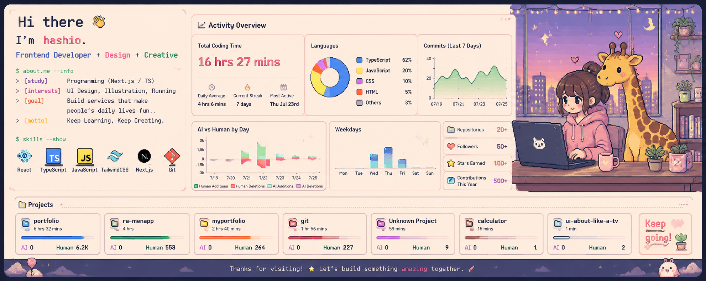

<!-- テーマのベース背景色 -->
<!-- &theme=calm&animation=draw&duration=3 -->

# 👋 Hi, I'm Hashio

Web開発やデザインを中心に、Webサイト制作やプログラミングの学習、作品制作に取り組んでいます。

I focus on web development and design, engaging in activities such as website creation, learning programming, and producing projects.

<!--  -->

## 📁 Repository Categories

GitHub上のリポジトリは、制作内容ごとに番号で分類しています。

Repositories on GitHub are categorized by number according to the content of the work.

| No.    | Category    | Description                                                                                              |
| ------ | ----------- | -------------------------------------------------------------------------------------------------------- |
| **00** | Practice    | プログラミングやWeb制作の学習・練習用<br>For learning and practicing programming and web development                      |
| **01** | Websites    | GitHub Pagesなどで公開しているWebサイト・Web制作物<br>Websites and web projects published on platforms like GitHub Pages |
| **02** | Small Works | 小作品・実験的な制作物・コレクション<br>Small-scale works, experimental projects, and collections                          |
| **03** | Python App  | Pythonを使って作成したアプリなど（Django、Flaskなど）<br>Create app for Python(To use Django, Flask)                        |
| **04** | JavaScript App  | JSを使って作成したアプリなど<br>Create app for JavaScript(To use Vanilla.js, React, Next.js)                        |
| **05** | Java App  | Javaを使って作成したアプリなど<br>Create app for Java(To use SpringBoot)                        |


---

## 🛠 Technologies & Skills & Tools --> (*) is learning mark

### Frontend
[](https://skillicons.dev)

* HTML
* CSS
* JavaScript(*)
* p5.js
* OpenProcessing
* React(*)
* Next.js(*)


### Backend / Programming
[](https://skillicons.dev)

* PHP(*)
* Python
* TypeScript(*)
* Java(*)
* Django
* Flask
* Pandas


### Database
[](https://skillicons.dev)
* MySQL
* PostgreSQL(*)

### CMS
[](https://skillicons.dev)
* WordPress

### Server / Hosting / DNS

* Docker(*)
* さくらインターネット
* お名前.com

### Development Tools
[](https://skillicons.dev)

* Visual Studio Code
* Eclipse
* Git
* GitHub
* GitHub Pages
* FileZilla

### Operating Systems
[](https://skillicons.dev)
* Windows
* macOS
* Linux
* Ubuntu
* Debian

### Shell / Command Line
[](https://skillicons.dev)
- PowerShell
- Bash
- Terminal


### Design Tools
[](https://skillicons.dev)
* Adobe Photoshop
* Adobe Lightroom
* Adobe Fresco
* Adobe Illustrator
* Adobe Premiere
* Adobe After Effects
* Adobe XD
* Figma
* Blender(*)


---

## 📊 GitHub Activity

[](https://github.com/stats-organization/github-stats-extended)


---

## 📈 GitHub Statistics


---


## 💻 Development Activity

<!--START_SECTION:waka-->


**🐱 My GitHub Data** 

> 📦 ? Used in GitHub's Storage 
 > 
> 🏆 1,069 Contributions in the Year 2026
 > 
> 🚫 Not Opted to Hire
 > 
> 📜 19 Public Repositories 
 > 
> 🔑 0 Private Repositories 
 > 
**I'm an Early 🐤** 

```text
🌞 Morning                157 commits         █████░░░░░░░░░░░░░░░░░░░░   18.09 % 
🌆 Daytime                407 commits         ████████████░░░░░░░░░░░░░   46.89 % 
🌃 Evening                225 commits         ██████░░░░░░░░░░░░░░░░░░░   25.92 % 
🌙 Night                  79 commits          ██░░░░░░░░░░░░░░░░░░░░░░░   09.10 % 
```
📅 **I'm Most Productive on Thursday** 

```text
Monday                   60 commits          ██░░░░░░░░░░░░░░░░░░░░░░░   06.91 % 
Tuesday                  112 commits         ███░░░░░░░░░░░░░░░░░░░░░░   12.90 % 
Wednesday                126 commits         ████░░░░░░░░░░░░░░░░░░░░░   14.52 % 
Thursday                 249 commits         ███████░░░░░░░░░░░░░░░░░░   28.69 % 
Friday                   183 commits         █████░░░░░░░░░░░░░░░░░░░░   21.08 % 
Saturday                 65 commits          ██░░░░░░░░░░░░░░░░░░░░░░░   07.49 % 
Sunday                   73 commits          ██░░░░░░░░░░░░░░░░░░░░░░░   08.41 % 
```


📊 **This Week I Spent My Time On** 

```text
🕑︎ Time Zone: Asia/Tokyo

💬 Programming Languages: 
HTML                     11 hrs 15 mins      ███████████████░░░░░░░░░░   60.29 % 
CSS                      3 hrs 33 mins       █████░░░░░░░░░░░░░░░░░░░░   19.08 % 
JavaScript               2 hrs 28 mins       ███░░░░░░░░░░░░░░░░░░░░░░   13.27 % 
PHP                      57 mins             █░░░░░░░░░░░░░░░░░░░░░░░░   05.12 % 
Markdown                 14 mins             ░░░░░░░░░░░░░░░░░░░░░░░░░   01.33 % 

🔥 Editors: 
VS Code                  18 hrs 41 mins      █████████████████████████   100.00 % 

🐱‍💻 Projects: 
Unknown Project          12 hrs 49 mins      █████████████████░░░░░░░░   68.61 % 
04_js_colorcode-map      3 hrs 57 mins       █████░░░░░░░░░░░░░░░░░░░░   21.15 % 
99_portfolio             1 hr 40 mins        ██░░░░░░░░░░░░░░░░░░░░░░░   08.97 % 
13                       10 mins             ░░░░░░░░░░░░░░░░░░░░░░░░░   00.93 % 
01_myportfolio           3 mins              ░░░░░░░░░░░░░░░░░░░░░░░░░   00.33 % 

💻 Operating System: 
Mac                      18 hrs 41 mins      █████████████████████████   100.00 % 
```

🤖 **AI Coding This Week** 

```text
⏱ AI Coding Time: 1 hr 37 mins (8.71%)

✍️ 0 lines written by AI, 5,810 lines written by hand (0.0% AI-written)

🔤 612,767 Input Tokens, 7,536 Output Tokens

💵 $1.95 Estimated AI Cost This Week

🧠 1 AI Sessions, 23 AI Prompts

Github-Copilot           0 lines             ░░░░░░░░░░░░░░░░░░░░░░░░░   00.00 % 

🔎 AI Coding Insights:
🧑‍💻 Mostly Hands-On — 0.0% of written lines came from AI
📝 Concise Prompter — average 165 characters per prompt
🔁 Iterative Prompter — average 23 prompts per session
🔍 Hands-On Reviewer — 100.0% of changed lines were hand-edited
```

**I Mostly Code in JavaScript** 

```text
JavaScript               6 repos             ████████░░░░░░░░░░░░░░░░░   30.00 % 
HTML                     5 repos             ██████░░░░░░░░░░░░░░░░░░░   25.00 % 
Java                     2 repos             ██░░░░░░░░░░░░░░░░░░░░░░░   10.00 % 
PHP                      1 repo              █░░░░░░░░░░░░░░░░░░░░░░░░   05.00 % 
CSS                      1 repo              █░░░░░░░░░░░░░░░░░░░░░░░░   05.00 % 
```


**Timeline**


 Last Updated on 14/10/2026 21:52:31 UTC
<!--END_SECTION:waka-->


---

## 🌈 GitHub 3D Contribution


---


## 🎓 Certifications

- 情報セキュリティマネジメント試験 — 2026年5月取得
  - Information Security Management Examination — Obtained in May, 2026
- 3級 ウェブデザイン技能士 — 2026年9月取得
  - Grade 3 Web Design Technician — Obtained in September, 2026

---

## 🌱 Currently Learning

フロントエンド・バックエンドのWeb開発を中心に、サーバー・DNS・データベースなど、WebサイトやWebアプリケーションが動く仕組みについて学んでいます。

I am learning about the mechanisms that power websites and web applications—including servers, DNS, and databases—with a primary focus on frontend and backend web development.


また、GitHubを活用したバージョン管理やチーム開発、Issue・Projects・Pull Requestなどを使った開発フローについても学習しています。

I am also learning about version control and team development using GitHub, as well as development workflows that utilize features such as Issues, Projects, and Pull Requests.

---

## 👩‍💻 Team Development

#### Habito　2026/02

Django を使用したチーム開発プロジェクト。

- アプリの企画・コンセプト設計
- フロントエンドのUI・画面実装を担当
- 既存デザインをもとに、PC版からSP対応まで一から実装（AI未使用）
- CSSによるレスポンシブ対応・レイアウト調整
- UXを考慮したデザインの微調整・最終確認
- GitHubを使用したチーム共同開発

Repository: Public  
https://github.com/Tech-Jam-KDG-2026-Winter/Team-8-Django


#### tyutai-kun　2026/07 - 08

Next.js / TypeScript を使用したチーム開発プロジェクト。

- フロントエンドのUI・画面実装を担当
- 既存UIの改善・調整
- CSSによるレイアウト・デザインの微調整
- GitHubを使用したチーム共同開発

Repository: Private  
https://github.com/manabeai/tyutai-kun

---

## 📌 Portfolio

GitHub Pagesやポートフォリオサイトを通して、制作したWebサイトや作品を公開しています。

I showcase the websites and projects I have created via GitHub Pages and my portfolio site.

---


## 🔗 GitHub Pages Collection

### 🌐 Portfolio Website

[🔗 View Project](https://hashio251.github.io/)

Web開発・デザイン・プログラミング作品をまとめたポートフォリオサイトです。

**Tech Stack:** HTML / CSS / JavaScript / jQuery

---

### 🎨 Art Thinking Project — THIS IS ME

[🔗 View Project](https://hashio251.github.io/01_website_performance-artthinking-/)

学校の授業「アートシンキング」で、「THIS IS ME」をテーマに制作したWeb作品です。
※AI使用あり

**Tech Stack:** HTML / CSS / JavaScript

---

### 👕 Art Thinking Project — Future of ZOZOTOWN

[🔗 View Project](https://hashio251.github.io/01_website_presentation-artthinking-/)

学校の授業「アートシンキング」で制作したWeb作品です。ECサイトでの購買が主流となった現在をもとに、5年後のZOZOTOWNをテーマとして表現しました。
※AI使用あり

**Tech Stack:** HTML / CSS / Tailwind CSS

---

### 💅 Nail Salon Website

[🔗 View Project](https://hashio251.github.io/01_website_nailsalon/)

友人のネイルサロンを想定して制作したWebサイトです。
※AI使用あり

**Tech Stack:** HTML / CSS / JavaScript

---

### 📺 UI About Like a TV

[🔗 View Project](https://hashio251.github.io/02_smallworks_ui-about-like-a-tv/)

レトロなテレビをモチーフに、画面や操作部分をイメージして制作したUI作品です。

**Tech Stack:** HTML / CSS / JavaScript

---

### 🎮 Positive Personality Diagnosis Game

[🔗 View Project](https://hashio251.github.io/00_smallapp_diagnosis-game/)

質問に答えることで、自分の良いところを診断できるミニゲームです。

**Tech Stack:** HTML / CSS / JavaScript


